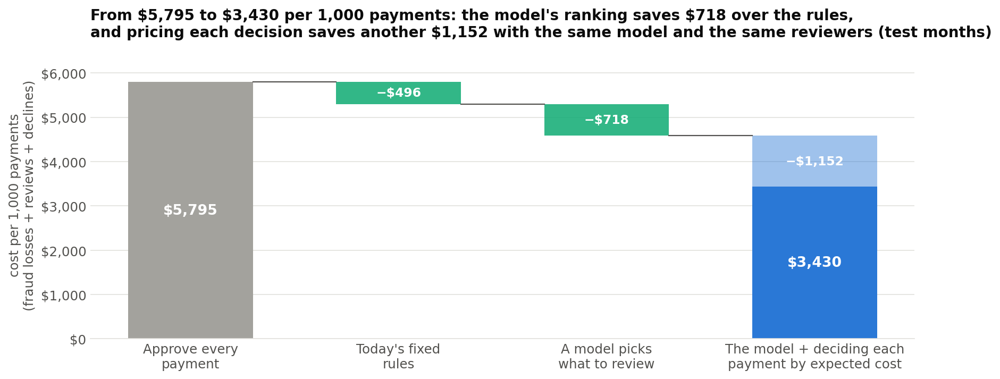
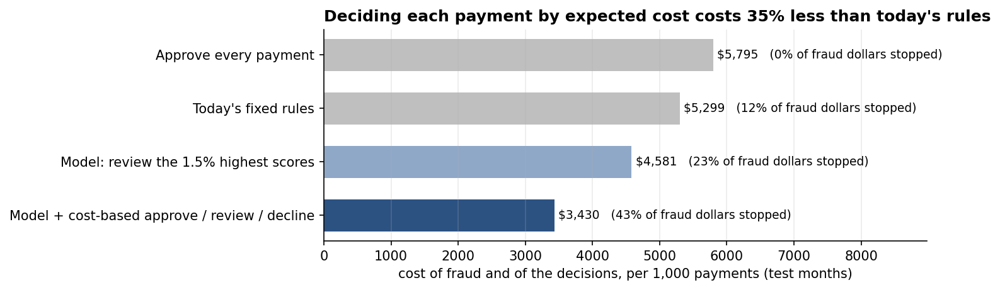

# Card-Not-Present Fraud: From a Score to a Decision

[](https://github.com/janeruxi1/card-fraud-decisioning/actions)

[](https://janeruxi1-card-fraud-decisioning.streamlit.app/)

**[Decision memo](reports/decision_memo.md)** · **[Live demo](https://janeruxi1-card-fraud-decisioning.streamlit.app/)** · **[Full results](docs/results.md)** · **[Model card](reports/model_card.md)** · **[Serving design](reports/serving_design.md)**

An online merchant must approve, decline or send to review every card payment, and its team can review
1.5% of them. Built on **590,540 real e-commerce payments** (IEEE-CIS release, 3.50% fraud, 182 days): find
the trap in how fraud is labelled, build features that only use the past, train and calibrate a model on
earlier months, price every decision in dollars, and measure what late chargebacks hide after launch. CI
checks every number below against the recorded results.

## Key results

- **Don't trust a random train/test split here.** Fraud labels follow the customer: recognizing customers
  already labelled fraud finds **74%** of fraud in a random hold-out but **16%** in later months, so every
  result is judged on later months.
- **The model finds 35% of fraud** [95% interval 32–38%] in the 1.5% of payments the team can review,
  against 2% for today's rules, and as much from customers new to fraud (**35%**) as from repeat victims.
- **Deciding by cost, not by score, saves the most:** **$3,430 per 1,000 payments** against $5,299 under
  today's rules, while declining fewer good customers (3 against 8 of 89,214). The decision layer alone,
  with the same model and reviewers, saves **$1,152** [95% interval $794–$1,534].
- **Watch it after launch.** Recall ends 9 points lower two months on, a week after a period ends only
  **29%** of its fraud is labelled, and a shadow trial needs 4 days of traffic but about ten weeks of chargebacks.



*What each way of handling payments costs per 1,000 test-month payments, in fraud losses plus review and
decline costs, and where each saving comes from. Drawn from the recorded results by `scripts/make_readme_figure.py`.*

## How it works

| Step | Method | Where |
|---|---|---|
| Audit | DuckDB SQL on the raw tables; approximate customer keys; label-propagation and leakage measurement | [01](notebooks/01_audit.ipynb) |
| Point-in-time features | SQL window functions over strictly earlier payments; a truncation test that no feature sees the future (0 values changed) | [02](notebooks/02_features.ipynb) |
| Model | Logistic regression vs LightGBM with and without the provider's `V` columns; Optuna inside the training months; chosen by decision cost, with a paired bootstrap of the margin; isotonic calibration; SHAP reason codes | [03](notebooks/03_model.ipynb) |
| Anomaly detection | Isolation Forest and a robust distance without labels: no better than chance here | [04](notebooks/04_anomaly.ipynb) |
| Decision policy | Expected-cost approve / review / decline under daily capacity; guardrail chosen on validation; sensitivity to every cost; weak segments; value of capacity; shadow-trial length | [05](notebooks/05_policy.ipynb) |
| Monitoring | Frozen vs refitted model with intervals per window; PSI drift; simulated chargeback delay; reviewers' same-day hit rate | [06](notebooks/06_monitoring.ipynb) |



*Left: the leak a random split would hide. Middle: what each way of handling payments costs on the test
months, in fraud losses plus review and decline costs. Right: how slowly fraud labels arrive.*

## Data

The IEEE-CIS Fraud Detection release (Kaggle, 2019): anonymized card-not-present payments from an
e-commerce payments provider. The data are not redistributed (see [`data/raw/README.md`](data/raw/README.md));
CI runs everything on a synthetic table with the same schema. The merchant, its costs and its review team
are a scenario ([brief](reports/scenario_brief.md)).

## Limits

- Costs, review accuracy and chargeback delays are assumptions; every headline is shown with its sensitivity.
- Inputs are heavily anonymized, so reason codes name a signal (`C1`, `V258`), not its meaning.
- The top two models are a statistical tie, and six months of data cover two months of decay and no seasonality.

<details>
<summary><b>Run it</b></summary>

```bash
pip install -r requirements.txt
python scripts/prepare_data.py                 # needs data/raw/train_*.csv, see data/raw/README.md
python scripts/build_notebooks.py --execute    # runs 01-06 on the real data, writes reports/metrics
pytest
streamlit run app/streamlit_app.py             # the demo: reads only reports/metrics
```

Without the data, `FRAUDRISK_SYNTHETIC=1 python notebooks/01_audit.py` runs on a synthetic table; synthetic
runs never overwrite `reports/metrics/`.

</details>

<details>
<summary><b>Repository layout</b></summary>

```
reports/decision_memo.md     the recommendation; model_card.md, serving_design.md beside it
reports/metrics/*.json       every result (aggregates only); docs/results.md = full results
notebooks/0N_*.py / .ipynb   one notebook per phase
sql/                         DuckDB SQL: audit queries and point-in-time features
src/fraudrisk/               data, synthetic table, audit, features, model, anomaly, policy, monitoring
app/streamlit_app.py         the demo, including a policy calculator on aggregated cells
tests/                       known-answer tests, the leakage check, policy optimality, doc numbers vs records
```

</details>

**Related:** [Churn and retention](https://github.com/janeruxi1/churn-uplift-decisioning) ·
[A/B testing on real experiments](https://github.com/janeruxi1/ab-testing-real-experiments) ·
[All projects](https://github.com/janeruxi1)
