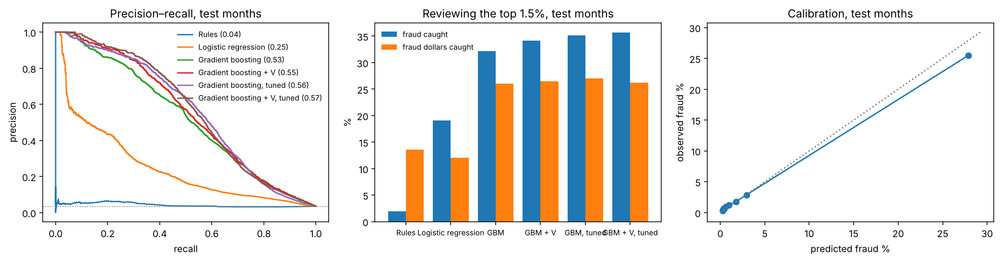
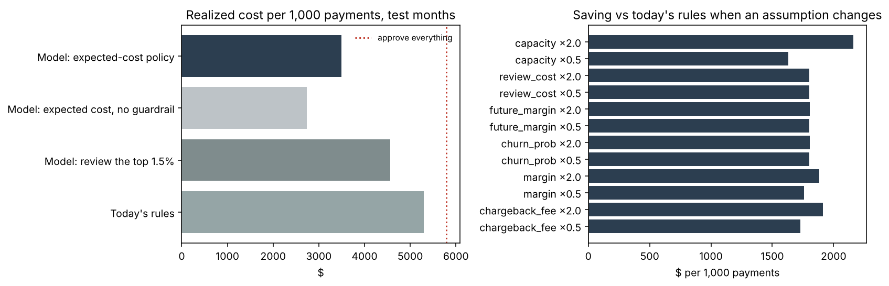

# Card-Not-Present Fraud: From a Score to a Decision

[](https://github.com/janeruxi1/card-fraud-decisioning/actions)
[](https://www.python.org/)

**[Decision memo](reports/decision_memo.md)** · **[Model card](reports/model_card.md)** · **[Notebooks](notebooks/)** ·
Every number below is read from `reports/metrics/`, and CI checks the key ones in this README and the memo against those records.

An online merchant has to approve, decline or send to manual review every card payment, with a review
team that can look at 1.5% of them. This project builds that decision on **590,540 real e-commerce
payments**: it finds the trap in how fraud is labelled, builds features that only use the past, trains
and calibrates a model on earlier months and judges it on later ones, prices every decision in dollars,
and measures how the model decays when fraud labels arrive weeks late.

**Data:** the IEEE-CIS Fraud Detection release (Kaggle, 2019), anonymized card-not-present transactions
from an e-commerce payments provider: 590,540 payments over 182 days, 3.50% fraud. The data belong to the
provider and are not redistributed here; see [`data/raw/README.md`](data/raw/README.md). The merchant,
its costs and its review team are a scenario ([brief](reports/scenario_brief.md)).

## Results

| Question | Answer | Notebook |
|---|---|---|
| How is fraud labelled, and what would leak? | Labels follow the customer: after a payment labelled fraud, the customer's next payment is fraud **77%** of the time, against **0.96%** otherwise. Recognizing customers already labelled fraud finds **74%** of fraud in a random hold-out but **16%** in later months, so every result here is measured on later months. | [01](notebooks/01_audit.ipynb) |
| Can the features see the future? | No: rebuilding them with everything after three cutoffs deleted changed **0** values. 40% of payments are a customer's first, with no history to use. | [02](notebooks/02_features.ipynb) |
| How well can fraud be ranked on unseen months? | Gradient boosting puts **34% of fraud** [95% interval 32–37%] and 26% of fraud dollars in the top 1.5% of scores, at 79% precision; logistic regression 19%. It finds **35%** of fraud from customers new to fraud, so it recognizes fraud, not just fraudsters. Calibrated: Brier 0.0219 vs 0.0336 for the base rate. | [03](notebooks/03_model.ipynb) |
| Do anomaly detectors that need no labels help? | No better than chance here (Isolation Forest PR-AUC **0.038** at a 0.035 fraud rate). Its most "unusual" payments come from heavy legitimate customers (median **702** earlier payments). With just 111 fraud labels, a supervised model already reaches PR-AUC 0.37. | [04](notebooks/04_anomaly.ipynb) |
| What should we do with each payment? | An expected-cost policy costs **$3,869 per 1,000 payments** against $5,795 for approving everything and $4,559 for reviewing the model's top scores: the decision layer alone saves **$690** [95% interval $318–$1,116] with the same model and the same reviewers. | [05](notebooks/05_policy.ipynb) |
| What does the good-customer guardrail cost? | Without it the policy would decline 1.25% of good customers and cost $2,811 per 1,000 payments. By the brief's costs the guardrail costs **$1,058 per 1,000 payments**; it pays off only if a wrongly declined customer costs more than the brief assumes. That is a decision for finance, made visible. | [05](notebooks/05_policy.ipynb) |
| How fast does it decay, and when would we know? | Recall at capacity falls from **39%** to **28%** over the two months after training; refitting on the labels available at the time does not help. A week after a period ends only **29%** of its fraud labels are in. The score's distribution barely moves (PSI ≤ 0.03), but reviewers' same-day verdicts do: the queue's hit rate fell from **92%** to **72%**. | [06](notebooks/06_monitoring.ipynb) |



## The decision

| Policy, test months | Cost per 1,000 payments | Fraud dollars stopped | Good customers declined |
|---|---|---|---|
| Approve everything | $5,795 | 0% | 0% |
| Rules stand-in (review / decline on fixed rules) | $5,299 | 12% | 0.01% |
| Model: review the top 1.5% of scores | $4,559 | 23% | 0% |
| **Model: expected-cost policy** | **$3,869** | **35%** | **0.01%** |
| Model: expected cost, no guardrail | $2,811 | 61% | 1.25% |

Each payment gets the action with the lowest expected cost from its calibrated fraud probability and the
scenario's costs (lost order + chargeback fee; lost margin and customer; review time). Reviews go, day by
day and within capacity, where a review saves the most dollars, which means large orders: 22% of orders
over $1,000 are reviewed. Declines are allowed only above a probability threshold (0.94) chosen on the
validation months so that good customers are declined no more often than under the rules. Every cost
assumption halved or doubled leaves the saving positive (smallest: $1,035 per 1,000 payments against the
rules stand-in).



## What makes this data hard

- **The label is partly a property of the customer.** The provider labels a customer's later payments
  fraud after a chargeback, so a random split rewards memorizing customers (74% vs 16% above). The model
  is judged on later months, and its recall is reported separately for customers new to fraud.
- **It is heavily anonymized.** Card, address and device fields are codes; 339 `V` columns are the
  provider's engineered features with no documentation. They add 0.014 validation PR-AUC, so they are in
  the model, and the model without them is reported alongside (PR-AUC 0.526 vs 0.552).
- **Most customers have little history.** The median approximate customer has one payment, which caps
  what history features can do.
- **Costs and label delays are assumptions.** The data has no margins, review outcomes or chargeback
  dates; they live in one config file and every headline is shown with its sensitivity.
- **The rules stand-in is weak** (ROC AUC 0.51 on this data); the merchant's real rules are not in the
  data, so the policy is compared with approving everything and with the model's own top scores as well.

## How it was built

| Phase | What | Techniques |
|---|---|---|
| 0 | [Brief, metrics, plan](PROJECT_PLAN.md) | Decision framing: costs, review capacity, guardrails; time split fixed before modelling |
| 1 | [Audit](notebooks/01_audit.ipynb) | DuckDB SQL on the raw tables ([`sql/`](sql/)); approximate customer keys from card, address and `D1`; label-propagation and leakage measurement; missing-together column blocks |
| 2 | [Point-in-time features](notebooks/02_features.ipynb) | SQL window functions over strictly earlier transactions (velocity, amount vs history, email/device changes); a truncation test that no feature sees the future |
| 3 | [Supervised models](notebooks/03_model.ipynb) | Rules stand-in, logistic regression, LightGBM with and without the provider columns; time split with early stopping on validation months; PR-AUC, recall and dollar recall at capacity; customer-level bootstrap; isotonic calibration; SHAP reason codes |
| 4 | [Anomaly detection](notebooks/04_anomaly.ipynb) | Isolation Forest and a robust-distance score without labels; who the anomalies are; capacity blending; label-scarcity curve |
| 5 | [Decision policy](notebooks/05_policy.ipynb) | Expected-cost approve / review / decline; daily capacity; guardrail threshold chosen on validation; bootstrap; sensitivity to every assumption |
| 6 | [Decay and monitoring](notebooks/06_monitoring.ipynb) | Frozen vs refitted on available labels; PSI drift; simulated chargeback delay; same-day signals |
| 7 | Packaging | Package, tests, CI on a synthetic table with the same schema, model card, demo on aggregates only |

## Run it

```bash
pip install -r requirements.txt
python scripts/prepare_data.py                 # needs data/raw/train_*.csv, see data/raw/README.md
python scripts/build_notebooks.py --execute    # runs 01-06 on the real data, writes reports/metrics
pytest
```

Each analysis lives in a `.py` file in `notebooks/` (the source of truth, run by CI) and a generated
`.ipynb` beside it, executed on the real data so GitHub shows every table and figure. Without the data,
`FRAUDRISK_SYNTHETIC=1 python notebooks/01_audit.py` runs on a synthetic table with the same columns and
the same labelling rule; this is what CI does, and synthetic runs never overwrite `reports/metrics/`.

```bash
pip install -r app/requirements.txt
streamlit run app/streamlit_app.py             # the demo: reads only reports/metrics
```

## Repository layout

```
reports/decision_memo.md     the recommendation
reports/model_card.md        what the model is, how it was checked, where it fails
reports/metrics/*.json       every result, written by the notebooks (aggregates only)
notebooks/0N_*.py / .ipynb   one notebook per phase
sql/                         DuckDB SQL: audit queries and point-in-time features
src/fraudrisk/               data, synthetic table, audit, features, model, anomaly, policy, monitoring, demo
app/streamlit_app.py         the demo, including a policy calculator on aggregated cells
tests/                       known-answer tests, the leakage check, policy optimality, memo/README numbers vs records
```

## Related projects

- [StreamFlix A/B Testing](https://github.com/janeruxi1/StreamFlix-AB-Testing)
- [StreamFlix Churn & Retention](https://github.com/janeruxi1/StreamFlix-Churn-Retention)
- [StreamFlix RAG Evaluation](https://github.com/janeruxi1/StreamFlix-RAG-evaluation)
- [Hotel Search Ranking](https://github.com/janeruxi1/Hotel-Search-Ranking)
- [Ride-hailing Driver Pay](https://github.com/janeruxi1/ridehail-driver-pay-optimization)
# card-fraud-decisioning

