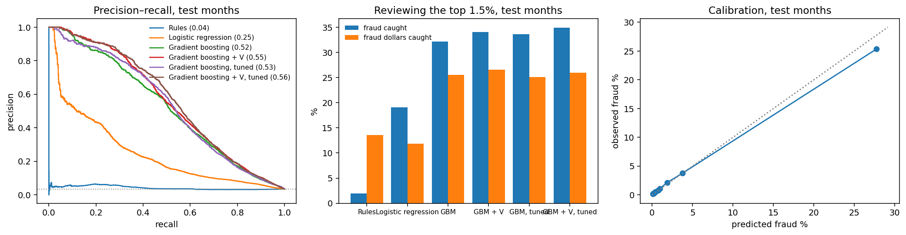
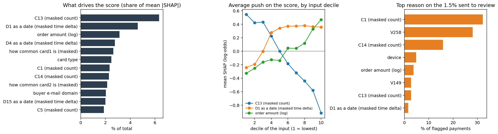
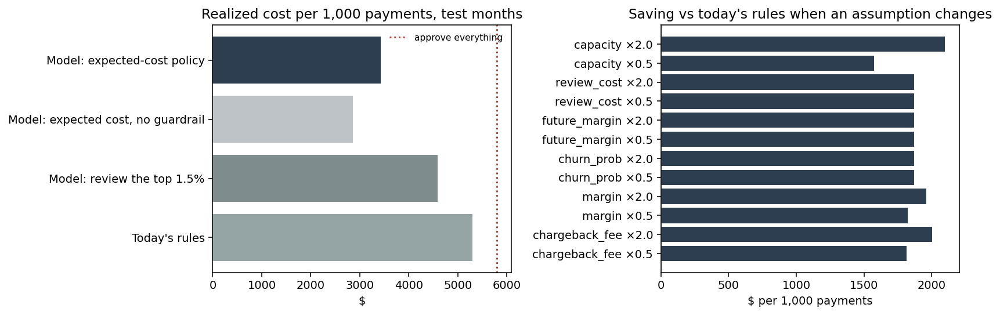
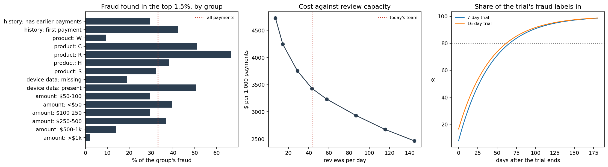

# Card fraud decisioning: full results

[← Back to the README](../README.md)

## Results

| Question | Answer | Notebook |
|---|---|---|
| How is fraud labelled, and what would leak? | Labels follow the customer: after a payment labelled fraud, the customer's next payment is fraud **77%** of the time, against **0.96%** otherwise. Recognizing customers already labelled fraud finds **74%** of fraud in a random hold-out but **16%** in later months, so every result here is measured on later months. | [01](../notebooks/01_audit.ipynb) |
| Can the features see the future? | No: rebuilding them with everything after three cutoffs deleted changed **0** values. 40% of training payments are a customer's first, with no history to use. | [02](../notebooks/02_features.ipynb) |
| How well can fraud be ranked on unseen months? | The chosen model puts **35% of fraud** [95% interval 32–38%] and 26% of fraud dollars in the top 1.5% of scores, at 81% precision; logistic regression 19%. On fraud from customers new to fraud it finds **35%**. Calibrated: Brier 0.0214 vs 0.0336 for the base rate. | [03](../notebooks/03_model.ipynb) |
| Which model, and does tuning help? | 40 Optuna trials inside the training months raised PR-AUC there from 0.586 to 0.624. Four boosting models (default or tuned, with or without the provider's `V` columns) were compared by **the cost of their decisions on the validation months**; the tuned model with `V` won by **$12** per 1,000 payments. Priced on the same payments with customers resampled, its lead over the runner-up is $12 [95% interval -$131 to $151] on the validation months and $16 [-$130 to $162] on the test months: **the two are indistinguishable**, so the choice between them should rest on something else, such as explainability. | [03](../notebooks/03_model.ipynb) |
| Do anomaly detectors that need no labels help? | No better than chance here (Isolation Forest PR-AUC **0.038** at a 0.035 fraud rate). Its most "unusual" payments come from heavy legitimate customers (median **702** earlier payments). With just 111 fraud labels, a supervised model already reaches PR-AUC 0.37. | [04](../notebooks/04_anomaly.ipynb) |
| What should we do with each payment? | An expected-cost policy costs **$3,430 per 1,000 payments** against $5,795 for approving everything and $4,581 for reviewing the model's top scores: the decision layer alone saves **$1,152** [95% interval $794–$1,534] with the same model and the same reviewers. | [05](../notebooks/05_policy.ipynb) |
| What does the good-customer guardrail cost? | Without it the policy would decline 1.32% of good customers and cost $2,855 per 1,000 payments. By the brief's costs the guardrail costs **$575 per 1,000 payments**; it pays off only if a wrongly declined customer costs more than the brief assumes. That is a decision for finance, made visible. | [05](../notebooks/05_policy.ipynb) |
| Is the guardrail met, and can we tell? | Met: the policy declined **3** good payments out of 89,214 against **8** under the rules. But the difference, -0.6 per 10,000 good payments [95% interval -1.3 to +0.1], rests on a handful of customers; a strict "no more than the rules" test can flip on one person, so finance should set a margin. | [05](../notebooks/05_policy.ipynb) |
| Where is the model weak? | Product `W`, 42% of the fraud: the top 1.5% finds only **9%** of it (product `C`: 51%). Payments without device data: **19%** (with it: 50%). Above $1,000 today's rules beat the policy (on only 45 frauds), so keep the large-order rule as a floor. First payments are not a weak spot (42% against 30% for returning customers). | [05](../notebooks/05_policy.ipynb) |
| Is more review capacity worth it? | Yes, with falling returns: around today's 1.5%, each extra review a day saves about **$39** after its $6 cost; reviewing 2% of payments would bring the cost to $3,234 per 1,000 payments. | [05](../notebooks/05_policy.ipynb) |
| How fast does it decay, and when would we know? | Recall at capacity is **37%** in the first 15 days after training and **28%** two months later, a change of -9 points [95% interval -13 to -5], though not in a straight line (30% and 37% in between); refitting on the labels available at the time does not help. A week after a period ends only **29%** of its fraud labels are in. The score's distribution moves little (PSI ≤ 0.069), but reviewers' same-day verdicts do: the queue's hit rate fell from **88%** to **72%**. | [06](../notebooks/06_monitoring.ipynb) |
| How long should the shadow trial run? | Payments are not the limit: 4 days would detect the saving against the rules. Chargebacks are: 80% of a one-week trial's fraud labels are in **67 days** after it ends, so the readout comes about 11 weeks after the start. Telling the two leading models apart would take about **10,000 days** of payments, so the trial cannot settle that. | [05](../notebooks/05_policy.ipynb) |

*Model detail. Left: precision against recall for each model. Middle: fraud (and fraud dollars)
caught when reviewing the top 1.5% of scores. Right: predicted against observed fraud rate.*

*Explanations, as aggregates. Left: the inputs that move the score most (SHAP). Middle: whether low
or high values of the three strongest numeric inputs push towards fraud. Right: the first reason a
reviewer would see on the payments sent to review. Most inputs are masked by the provider.*

## The decision

| Policy, test months | Cost per 1,000 payments | Fraud dollars stopped | Good customers declined |
|---|---|---|---|
| Approve everything | $5,795 | 0% | 0% |
| Rules stand-in (review / decline on fixed rules) | $5,299 | 12% | 0.009% |
| Model: review the top 1.5% of scores | $4,581 | 23% | 0% |
| **Model: expected-cost policy** | **$3,430** | **43%** | **0.003%** |
| Model: expected cost, no guardrail | $2,855 | 60% | 1.32% |

Each payment gets the action with the lowest expected cost from its calibrated fraud probability and the
scenario's costs (lost order + chargeback fee; lost margin and customer; review time). Reviews go, day by
day and within capacity, where a review saves the most dollars, which means large orders: about 15% of
orders over $500 are reviewed. Declines are allowed only above a probability threshold (0.96) chosen on
the validation months so that good customers are declined no more often than under the rules; on the
test months the policy declines 0.003% of good customers against 0.009% for the rules. Every cost
assumption halved or doubled leaves the saving against the rules stand-in positive (smallest: $1,575 per
1,000 payments).

*Left: the share of each group's fraud found in the top 1.5%. Middle: the policy's cost if the team
could review more or fewer payments a day. Right: how long after a shadow trial ends its chargebacks
are mostly in, which is when its cost can be read.*

## What makes this data hard

- **The label is partly a property of the customer.** The provider labels a customer's later payments
  fraud after a chargeback, so a random split rewards memorizing customers (74% vs 16% above). The model
  is judged on later months, and its recall is reported separately for customers new to fraud.
- **It is heavily anonymized.** Card, address and device fields are codes, and 339 `V` columns are the
  provider's engineered features with no documentation. The chosen model uses them, so its second most
  common reason code, `V258`, cannot be explained to a reviewer; the models without them cost $107–188
  more per 1,000 payments on the validation months.
- **Most customers have little history.** The median approximate customer has one payment, which caps
  what history features can do.
- **Costs and label delays are assumptions.** The data has no margins, review outcomes or chargeback
  dates; they live in one config file and every headline is shown with its sensitivity.
- **The rules stand-in is weak** (ROC AUC 0.51 on this data); the merchant's real rules are not in the
  data, so the policy is compared with approving everything and with the model's own top scores as well.

## How it was built

| Phase | What | Techniques |
|---|---|---|
| 0 | [Brief, metrics, plan](../PROJECT_PLAN.md) | Decision framing: costs, review capacity, guardrails; time split fixed before modelling |
| 1 | [Audit](../notebooks/01_audit.ipynb) | DuckDB SQL on the raw tables ([`sql/`](../sql/)); approximate customer keys from card, address and `D1`; label-propagation and leakage measurement; missing-together column blocks |
| 2 | [Point-in-time features](../notebooks/02_features.ipynb) | SQL window functions over strictly earlier transactions (velocity, amount vs history, email/device changes); a truncation test that no feature sees the future |
| 3 | [Supervised models](../notebooks/03_model.ipynb) | Rules stand-in, logistic regression, LightGBM with and without the provider columns; Optuna search inside the training months; model chosen by decision cost on the validation months, with a paired customer bootstrap of the margin; PR-AUC, recall and dollar recall at capacity; customer-level bootstrap; isotonic calibration; SHAP reason codes |
| 4 | [Anomaly detection](../notebooks/04_anomaly.ipynb) | Isolation Forest and a robust-distance score without labels; who the anomalies are; capacity blending; label-scarcity curve |
| 5 | [Decision policy](../notebooks/05_policy.ipynb) | Expected-cost approve / review / decline; daily capacity; guardrail threshold chosen on validation; bootstrap; sensitivity to every assumption; guardrail counts with an interval; errors by segment; value of review capacity; shadow-trial length from power and label delay |
| 6 | [Decay and monitoring](../notebooks/06_monitoring.ipynb) | Frozen vs refitted on available labels, with customer-resampled intervals per window; PSI drift; simulated chargeback delay; same-day signals |
| 7 | Packaging | Package, tests, CI on a synthetic table with the same schema, model card, demo on aggregates only |
